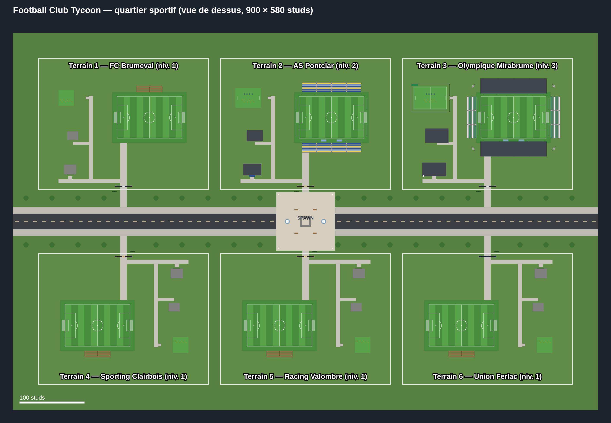
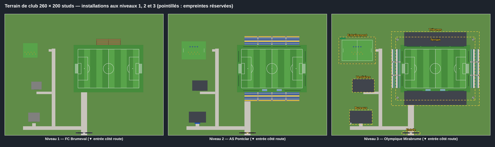

# Le monde de Football Club Tycoon

Ce dossier explique le **décor 3D** du jeu : le quartier sportif partagé et les
terrains de club. Tout est fabriqué **par du code** à partir de blocs Roblox
(des « Parts ») : il n'y a aucun fichier 3D à importer, aucun logo ni aucune
marque réels. Les noms de clubs et les publicités sont inventés.



## Ce qui a été modélisé

### Le quartier sportif (commun à tous les joueurs)

- Un grand terrain herbeux de **900 × 580 studs** (un personnage Roblox mesure environ 5 studs).
- **6 emplacements de club** : 2 rangées de 3, de part et d'autre d'une route centrale.
  Chaque emplacement mesure **260 × 200 studs** et est séparé du voisin par 20 studs.
- Une **route** avec marquage, des **trottoirs**, des **arbres**, des **allées** vers chaque club.
- Une **place centrale** pavée avec le **point d'apparition commun** (SpawnLocation),
  deux sculptures en forme de ballon, des bancs et des lampadaires.
- Devant chaque emplacement : une bordure blanche et un panneau « TERRAIN 1 » … « TERRAIN 6 ».

### Un terrain de club

Chaque club possède son terrain, avec un **portique d'entrée** côté route
(le nom du club y est écrit des deux côtés, et un écusson simple aux couleurs du
club est posé dessus), puis 5 installations qui évoluent sur **3 niveaux** :



| Installation | Niveau 1 | Niveau 2 | Niveau 3 |
|---|---|---|---|
| **Terrain principal** (`Pitch`) | Pelouse 100 × 64 studs à bandes de tonte, lignes (surfaces de réparation, rond central, points de penalty), buts avec filets, drapeaux de coin | + bancs de touche abrités, panneaux publicitaires fictifs | + éclairage : 4 pylônes avec projecteurs |
| **Tribunes** (`Stands`) | Petit gradin en bois sur un côté — **200 places** | Tribunes en béton sur les 2 grands côtés, sièges aux couleurs du club — **1 500 places** | Tribunes sur les 4 côtés, grands côtés plus hauts avec toit — **5 000 places** |
| **Vestiaires** (`LockerRoom`) | Petit bâtiment blanc avec un banc | Plus grand, béton, fenêtres, bandeau de couleur | Moderne, façade vitrée, casiers |
| **Zone d'entraînement** (`Training`) | Carré d'herbe avec des plots | Plus grande, mini-buts et mannequins | Terrain délimité avec clôture et abri |
| **Bureaux** (`Offices`) | Petit bâtiment en briques | Plus grand, fenêtres, auvent | Immeuble vitré sur 2 étages, enseigne au nom du club |

Les capacités des tribunes sont **provisoires** (à équilibrer pendant les tests).

À la porte des bureaux, un bouton d'interaction **« Gérer le club »** apparaît
quand on s'approche. Pour l'instant il **ne fait rien** : il sera relié plus tard
aux menus de gestion.

Un nouveau club commence avec toutes ses installations au **niveau 1**.

### Nombre de blocs (performances mobile)

| | Blocs (Parts) |
|---|---|
| Quartier commun | ~210 |
| Terrain tout niveau 1 | ~155 |
| Terrain tout niveau 2 | ~300 |
| Terrain tout niveau 3 | ~465 |

Objectif respecté : moins de 600 blocs par terrain au niveau maximum.

## Voir le monde dans Roblox Studio

1. **Installer Roblox Studio** (gratuit) depuis le site de Roblox.
2. **Installer Rojo** (l'outil qui envoie les fichiers du projet dans Studio) :
   - le programme : téléchargez-le sur la page des versions de Rojo
     (github.com/rojo-rbx/rojo, rubrique *Releases*), ou installez-le avec
     *Aftman*/*Rokit* si quelqu'un vous l'a configuré ;
   - le **plugin Studio** : dans Studio, onglet *Plugins* → *Manage Plugins*,
     ou en lançant une fois `rojo plugin install` dans un terminal.
3. Dans un terminal, placez-vous dans le dossier du projet puis tapez :
   ```
   rojo serve
   ```
4. Dans Studio, ouvrez un nouveau projet vide (*Baseplate*), puis dans l'onglet
   *Plugins* cliquez sur **Rojo** → **Connect**.
5. Cliquez sur **Play** (ou F5). Le quartier et les 6 terrains de démonstration
   apparaissent : terrain 1 au niveau 1, terrain 2 au niveau 2, terrain 3 au
   niveau 3, terrains 4 à 6 au niveau 1.

Astuce : si une plaque grise « Baseplate » est présente sous le quartier, vous
pouvez la supprimer, elle n'est pas utile.

### Quand l'aperçu s'affiche-t-il ?

L'aperçu est construit par le script `src/server/World/WorldPreview.server.lua`, **seulement si** :

- le réglage `PREVIEW_ON_START` vaut `true` dans `src/shared/WorldConfig.lua` ;
- **et** le service de jeu `ClubService` n'existe pas encore.

`ClubService` fait désormais partie du projet : c'est lui qui construit le
quartier et les 6 terrains (vides, puis au nom de chaque joueur qui arrive),
donc l'aperçu de démonstration ne se lance plus. Il resservira si on teste les
modèles seuls, sans ClubService.
Pour le couper à la main : mettez `WorldConfig.PREVIEW_ON_START = false`.

## Changer les couleurs ou les tailles

Tous les réglages sont dans **`src/shared/WorldConfig.lua`**. Ouvrez-le avec un
éditeur de texte (par exemple VS Code), modifiez une valeur, enregistrez :
Rojo l'envoie automatiquement dans Studio, il suffit de relancer **Play**.

| Je veux changer… | Réglage dans WorldConfig |
|---|---|
| Les couleurs des sols, bâtiments, pelouse… | `WorldConfig.COLORS` — par ex. `PitchGrassLight = Color3.fromRGB(88, 163, 74)` (rouge, vert, bleu de 0 à 255) |
| Les couleurs de chaque club (sièges, portique, écusson) | `WorldConfig.CLUB_COLORS` (une ligne par emplacement) |
| Les textes des panneaux publicitaires | `WorldConfig.AD_TEXTS` |
| La capacité des tribunes | `WorldConfig.STANDS_CAPACITY` |
| Les niveaux de départ | `WorldConfig.START_LEVELS` |
| La taille de la pelouse | `WorldConfig.PITCH_SIZE` (longueur, largeur) |
| L'espace entre les terrains, la largeur de la route | `PLOT_GAP`, `CORRIDOR_WIDTH`, `ROAD_WIDTH` |
| L'emplacement d'une installation sur le terrain | `WorldConfig.LAYOUT` |

Attention avec les tailles et les positions : elles ont été calculées pour que
rien ne se chevauche, même au niveau 3. Après un changement de ce type, demandez
à un développeur de relancer la vérification ci-dessous.

## Pour les développeurs

- Point d'entrée : `src/server/World/WorldBuilder.lua`
  - `WorldBuilder.buildDistrict(parent?)` — idempotent, parent par défaut `Workspace`.
  - `WorldBuilder.buildPlot(slotIndex, levels?, clubName?)` — crée `Workspace.Plot<N>`
    (détruit l'ancien), clés absentes = niveau 1. Accepte aussi `{ levels = …, clubName = … }`.
  - `WorldBuilder.setFacilityLevel(plot, facilityId, level)` — reconstruit une seule installation.
  - `WorldBuilder.setClubName(plot, name)`, `getPlot(i)`, `destroyPlot(i)`, `countParts(model)`.
- Identifiants d'installation : `Pitch`, `Stands`, `LockerRoom`, `Training`, `Offices`.
  Chaque installation est un `Model` enfant du terrain, du même nom, avec les attributs
  `Facility` et `Level` (et `Capacity` pour les tribunes) et une `PrimaryPart` invisible `Root`.
- Chaque terrain contient une Part `Spawn` (invisible, sans collision) derrière l'entrée,
  pour y téléporter le joueur, et les attributs `SlotIndex`, `ClubName`, `Level_<id>`.
- Le quartier contient `District.Slots.Slot1…Slot6` (repères invisibles au centre de chaque emplacement).
- Un module par installation : `Pitch.lua`, `Stands.lua`, `LockerRoom.lua`,
  `TrainingZone.lua`, `Offices.lua`, `Entrance.lua`, `District.lua` ; outils communs dans `PartUtil.lua`.

### Vérifier sans Studio

- `node tools/check-luau.js` — analyse syntaxe + types (mode `--!strict`) avec
  [luau-lsp](https://github.com/JohnnyMorganz/luau-lsp) et les définitions Roblox
  (variables `LUAU_LSP_BIN` et `ROBLOX_DEFS`, voir l'en-tête du script).
- `node tools/world-preview.js` — exécute les vrais modules dans une fausse API
  Roblox minimale (`tools/roblox-mock.luau`) avec le binaire
  [luau](https://github.com/luau-lang/luau/releases) (variable `LUAU_BIN`), vérifie
  que tout est ancré, qu'aucune Part ne sort de son terrain ni de son empreinte,
  compte les Parts, puis redessine les deux images de ce dossier (Playwright).
- `node tools/world-3d.js build/world-parts.json` — exporte toutes les Parts
  générées (taille, position, rotation, couleur, matériau) en JSON, pour
  l'aperçu 3D dans le navigateur (même variable `LUAU_BIN`).
